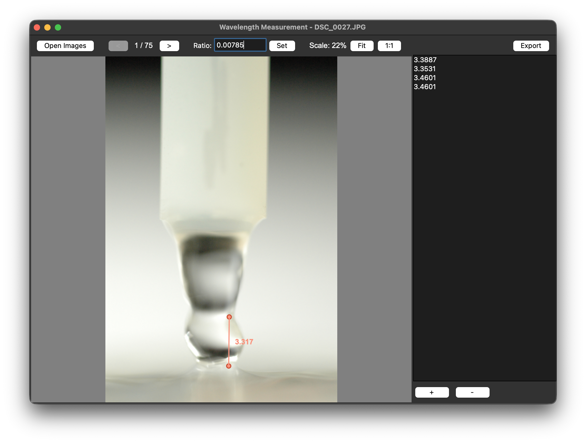
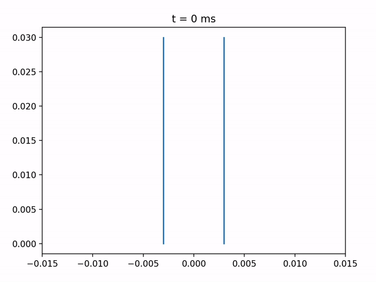

# Stationary Capillary Waves on Water Jets

Code supporting my physics research on stationary capillary waves generated when a water jet meets an obstacle.

| Measurement tool (`measure.py`) | Simulation (`sim.py`) |
| --- | --- |
|  |  |

## Contents

- `measure.py` — a Tkinter image-measurement tool for experimental photographs. Open multiple images, set a physical-length-per-pixel ratio, place and adjust line segments, and retain several measurements per image to estimate uncertainty. Measurements are exported as one `.txt` file per image, with one value per line.
- `sim.py` — a numerical visualization of the jet from obstacle contact onward. It evolves spatial-frequency (wavenumber) components analytically. A localized obstacle perturbation is represented as a constant forcing across wavenumbers. The phase of each component is evolved according to the capillary-wave dispersion relation and jet velocity, then damped based on wavenumber. The result converges toward a stationary pattern whose dominant wave has phase velocity matching the jet velocity.

## Requirements

Python 3 with:

```bash
pip install numpy scipy matplotlib pillow opencv-python
```

## Run

```bash
python measure.py
python sim.py
```

In the measurement app, choose **Open Images**, enter the calibrated length-per-pixel **ratio**, click two endpoints for a segment, optionally drag either endpoint to refine it, and press **+** to save the measurement. Use **Export** to write the saved values.

## Model parameters

The main parameters are near the top of `sim.py`, including surface tension, density, jet radius, velocity, damping, resolution, and amplitude scale.
